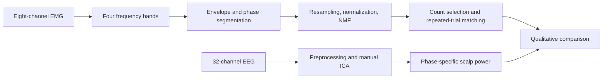
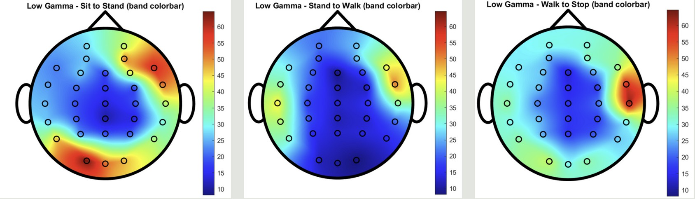

# EEG and Muscle Synergies During Transitional Movements

**A case study of lower-limb muscle coordination and EEG spectral topography.**

This project investigates how EMG-derived muscle co-activation modules vary during sit-to-stand (STS), stand-to-walk (STW), and walk-to-stop (WTS), and qualitatively compares these patterns with EEG scalp power. It forms part of Sing-Hao Wang's undergraduate capstone research on human-exoskeleton collaboration.

**Study scope: 10 trials from one participant.** The wider acquisition cohort contained 15 healthy participants, but this repository does not establish a 15-participant group result. Steady gait was not included in this synergy analysis. EEG-synergy coherence was not calculated.

## Research contribution

Sing-Hao Wang primarily implemented the code, assembled the processing workflow, analyzed the results, and prepared the research presentation (project-owner confirmation). The contribution integrates band-specific EMG processing, NMF extraction, repeated-trial matching, and EEG topographic visualization. External NMF solvers and EEG cleaning algorithms are not claimed as new algorithms.

## Data and methodology

The setup combined 32-channel EEG at 500 Hz, eight bilateral lower-limb sEMG channels at 1000 Hz, and four-camera markerless motion capture at 30 Hz. Participant recordings are not distributed with this portfolio.

The report describes Hilbert envelopes, resampling from 1000 to 500 Hz, nonnegative normalization, NMF (`V ≈ WH`), VAF-based selection, cosine-distance k-means, and one-to-one matching. **The archived script includes alternatives that overwrite shared variables, and its shuffle threshold differs from the report description.** [Methods](docs/METHODS.md) records the implemented formulas and unresolved issues. Numerical methods were preserved during portfolio preparation.

## Findings and evidence

The findings below are transcribed from the owner-supplied research brief summarizing report Chapter 5. They have not been independently recomputed from participant data.

| Reported observation | Scope and interpretation |
| --- | --- |
| Modal synergy count: STS = 3, STW = 3, WTS = 4 | Section 5.3.1, across 10 trials × four bands per phase. A later statement of three consensus synergies per phase conflicts with this; WTS remains unresolved. |
| LTA, RTA, and LBF co-activation at 30-45 Hz in STS and STW | Descriptive repeated-trial pattern within one participant. |
| RBF, LRF, and RRF co-activation in STS across four EMG bands | Qualitative observation, not a population-level effect. |
| Elevated right frontal and left occipital Beta/Low Gamma power in STS | Report-described scalp pattern; the missing acquisition montage prevents independent anatomical verification. |

L/R = left/right; GA = gastrocnemius, TA = tibialis anterior, BF = biceps femoris, RF = rectus femoris.

### Representative figures

**Beta topography (13-30 Hz; source Fig. 5.5a).** Columns show STS, STW, and WTS. The figure uses a shared scale within this band. These are descriptive power visualizations; no calibrated physical power unit or significance is asserted.

**Low Gamma topography (32-46 Hz; source Fig. 5.5b).** Its color scale differs from the Beta figure; do not compare the bands numerically using these scales. Visual correspondence does not demonstrate corticomuscular coupling.

Supplied synergy-average figures were excluded because their titles incorrectly state “10 subjects.” The plotting source now labels repeated trials from one participant. [Figure provenance](docs/FIGURES.md) records all selections and exclusions.

## Repository guide

| Location | Purpose |
| --- | --- |
| [EMG/EMG_data_preprocess.m](EMG/EMG_data_preprocess.m) | Band filtering, envelope alternatives, normalization, NMF, count selection, clustering, matching, and plots |
| [EEG/EEG_data_preprocess_32channel.m](EEG/EEG_data_preprocess_32channel.m) | EEG processing, manual ICA handoff, topographies, and exploratory EEG-only analyses |
| [Motion/define_transitional_stages.m](Motion/define_transitional_stages.m) | Motion-derived timing and EEG/EMG phase segmentation |
| [Function/](Function/) | Shared diagnostic plotting helpers |
| [research_paths.m](research_paths.m) | Configured private inputs and local output paths |
| [docs/REPRODUCIBILITY.md](docs/REPRODUCIBILITY.md) | Requirements, data contract, section order, and reproduction limits |

The established source folders are retained because the scripts share workspace variables. The root PDF remains legacy reference material and has not been cleared for public release; see [Data and publication](docs/DATA_AND_PUBLICATION.md).

## Requirements and use

Use MATLAB R2024a or later for the interspersed local-function layout, with Signal Processing Toolbox, Statistics and Machine Learning Toolbox, and DSP System Toolbox for the original analysis calls. External dependencies include EEGLAB/ASR, the original NMF solvers, `readNPY`, and a missing `plot_topography` helper.

These scripts require section-by-section review. There is no verified end-to-end command or bundled example dataset. Read the [reproduction guide](docs/REPRODUCIBILITY.md) before execution. Private paths are configured through environment variables; local results and common recording formats are ignored by Git.

## Limitations and future work

- Ten repeated trials from one participant cannot support between-participant generalization.
- Envelope selection, Hilbert dimension, NMF variant, shuffle criterion, and missing dependencies must be resolved before exact reproduction can be claimed.
- Unseeded randomization, phase alignment, and preprocessing affect the extracted modules. No new statistical significance or clinical efficacy is claimed.
- Quantitative EEG-synergy coupling and broader participant validation remain future work.

## Attribution and references

Source: Sing-Hao Wang, *Toward Digital Twin-Centered Human-Exoskeleton Collaboration: From Multi-Resolution Corticomuscular Coupling Analyses to an Incremental Mixture-of-Experts Locomotion Controller*, undergraduate capstone report, June 2026, Chapter 5, pp. 45-52, as summarized in the owner-supplied brief.

See [Attribution](docs/ATTRIBUTION.md) and [Verification](docs/VERIFICATION.md). Related project: [EEG-MUAP-analysis](https://github.com/stephen0701/EEG-MUAP-analysis).
