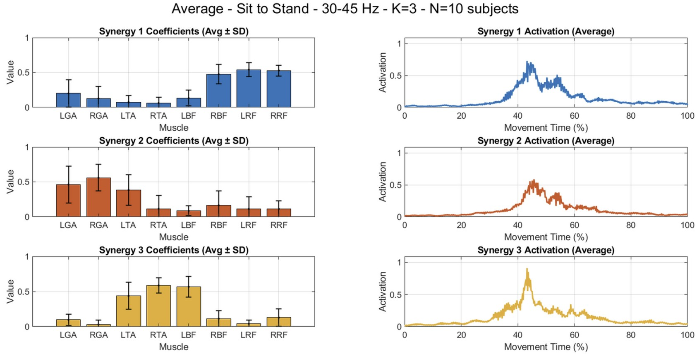
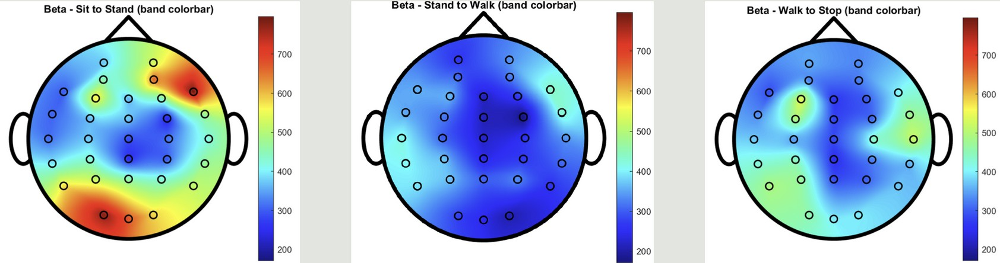

# EEG and Muscle Synergy Analysis

A case study of lower-limb muscle coordination and EEG scalp-power patterns during transitional movements.

[Results and figures](docs/RESULTS.md) · [Methods](docs/METHODS.md) · [Usage](docs/REPRODUCIBILITY.md) · [Project notes](docs/PROJECT_NOTES.md) · [Project report (PDF)](docs/reports/digital-signal-processing-of-cortical-and-muscular-dynamics.pdf)

## Research objective and scope

This undergraduate project examines EMG-derived muscle synergies during **sit to stand (STS), stand to walk (STW), and walk to stop (WTS)**, then compares them qualitatively with EEG spectral topography.

The analysis covers **10 trials from one participant**. The wider acquisition cohort included 15 healthy participants; this repository does not establish a group-level result. Steady gait was excluded, and quantitative EEG–synergy coherence was not calculated.

## Contributions

**Sing-Hao Wang** primarily implemented the code, integrated the processing workflow, analyzed the results, and prepared the research presentation. The work combines band-specific EMG analysis, NMF extraction, repeated-trial matching, and EEG visualization. Existing NMF solvers and EEG cleaning methods are credited as external methods; see [attribution](docs/PROJECT_NOTES.md#attribution-and-sources).

## Methodology

1. Align **eight-channel sEMG (1000 Hz)**, **32-channel EEG (500 Hz)**, and **markerless motion capture (30 Hz)** to movement phases.
2. Filter EMG into 10–30, 30–45, 45–120, and 135–280 Hz bands; extract envelopes, resample to 500 Hz, and normalize phase segments.
3. Extract nonnegative muscle weights and activations with NMF; select counts using the archived VAF/shuffle heuristic and match repeated trials with cosine-distance clustering and one-to-one assignment.
4. Preprocess EEG, review ICA manually, and plot phase-specific band power for qualitative comparison.

The [methods guide](docs/METHODS.md) records exact formulas, the corrected median-based shuffle criterion, and the envelope/NMF alternatives that require explicit selection.

## Key results

These observations are recorded in the project research summary and have not been independently recomputed from the original recordings.

| Observation | Interpretation |
| --- | --- |
| Modal synergy counts: STS = 3, STW = 3, WTS = 4 | A separate three-consensus-synergy statement conflicts with WTS = 4 and remains unresolved. |
| LTA/RTA/LBF co-activation at 30–45 Hz in STS and STW; RBF/LRF/RRF co-activation across STS bands | Descriptive patterns within one participant. |
| Reported right-frontal and left-occipital Beta/Low Gamma elevations during STS | Scalp-power observations; the original montage is unavailable for independent anatomical verification. |

L/R = left/right; TA = tibialis anterior, BF = biceps femoris, RF = rectus femoris.

## Representative figures

**STS synergies, 30–45 Hz (Fig. 5.3a).** The original title's “N=10 subjects” means **10 trials from one participant**; error bars are across-trial SD. Muscle weights and activations are descriptive case-study outputs.

**Beta topography, 13–30 Hz (Fig. 5.5a).** Columns show STS, STW, and WTS with a shared within-band scale. The map does not establish significant effects or quantitative corticomuscular coupling.

All **eight original figures**, including STW, other EMG bands, VAF, matching, and Low Gamma maps, remain in the [complete results gallery](docs/RESULTS.md), with necessary label and scale clarifications.

## Usage and repository guide

Use **MATLAB R2024a or later**, the required MathWorks toolboxes, EEGLAB/ASR, and the original external NMF/helper functions. Recordings and several acquisition dependencies are not distributed. Configure private input/output paths through `research_paths.m` and the documented environment variables.

Read the [reproduction guide](docs/REPRODUCIBILITY.md) before running sections. These scripts share workspace variables and contain alternatives that overwrite earlier results; running every section is not a verified report-reproduction procedure.

| Location | Purpose |
| --- | --- |
| [EMG/](EMG/) | EMG processing, NMF, count selection, matching, and plots. |
| [EEG/](EEG/) | EEG processing, manual ICA handoff, and spectral visualization. |
| [Motion/](Motion/) | Motion timing and EEG/EMG phase segmentation. |
| [Function/](Function/) | Shared diagnostic plotting helpers. |
| [docs/](docs/) | Methods, full results, reproduction, figure provenance, and project notes. |

## Limitations

Repeated trials from one participant do not establish population-level generalization. Missing recordings, montage, ICA/random-state logs, and helper files prevent exact reproduction. The archived Hilbert dimension and overwritten envelope/NMF alternatives remain documented issues. No new significance, clinical efficacy, or quantitative EEG–synergy coupling is claimed.

[Project notes](docs/PROJECT_NOTES.md) consolidate research sources, software verification, and data/release status. Related project: [EEG-MUAP-analysis](https://github.com/stephen0701/EEG-MUAP-analysis).

Academic citation metadata is available in [`CITATION.cff`](CITATION.cff). See [citation and reuse](docs/PROJECT_NOTES.md#citation-and-reuse) for the no-license status and third-party rights.
