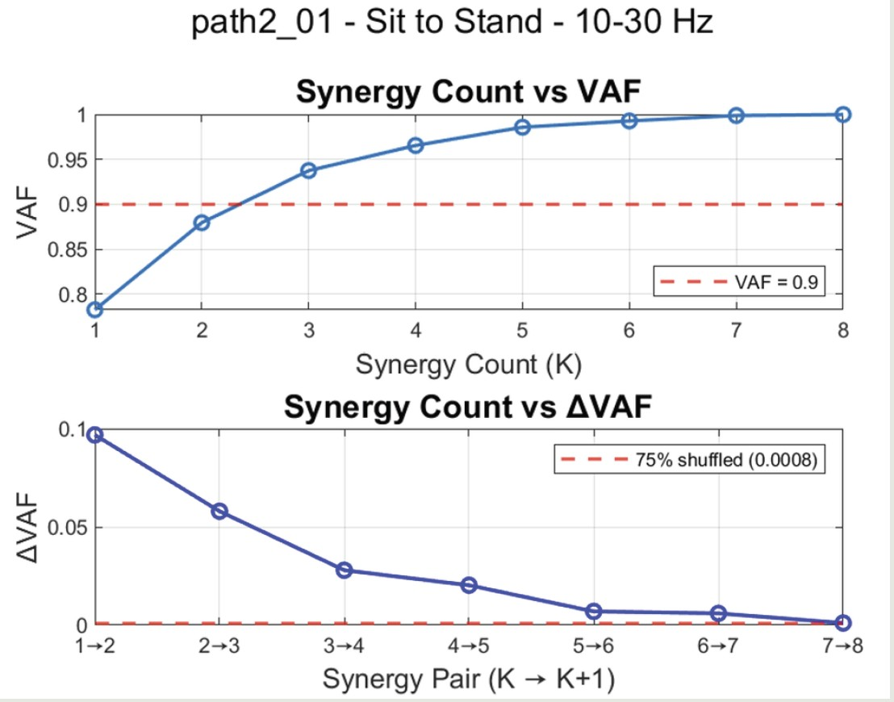
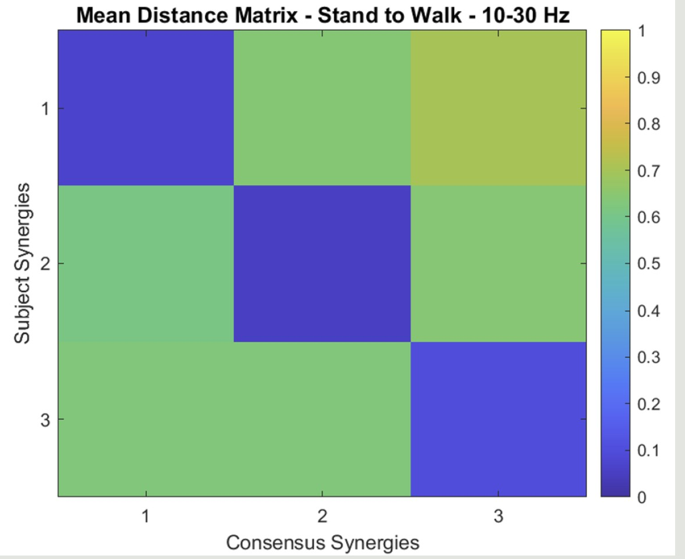
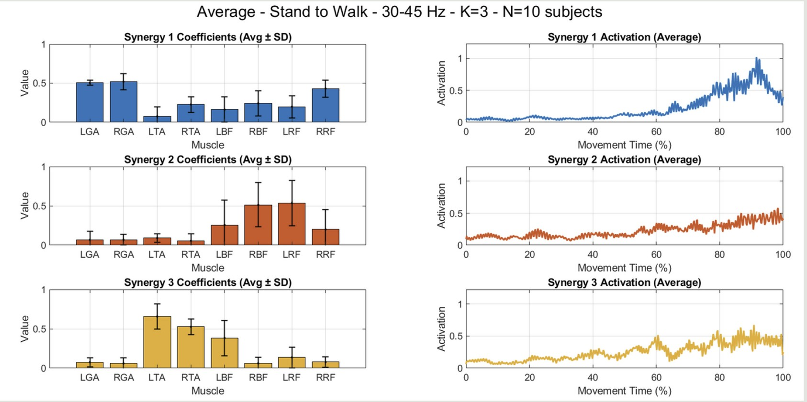
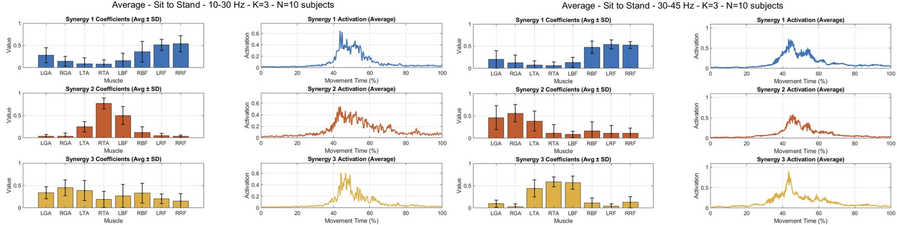
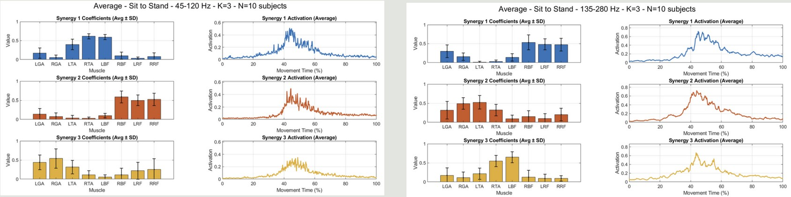

# Results and figure gallery

[README](../README.md) · [Methods](METHODS.md) · [Results](RESULTS.md) · [Reproduction](REPRODUCIBILITY.md) · [Project notes](PROJECT_NOTES.md)

This gallery preserves all eight Chapter 5 figures. They are report-era case-study illustrations, not regenerated outputs. The author confirmed that the study comprises ten trials from one participant, the archived median-based shuffle heuristic is the intended method, and all ten trials contributed to the matching matrix. These clarifications are author statements, not an independent data reanalysis.

## 1. Synergy-count selection

**Method correction for Fig. 5.1:** the report's “75th percentile” description should be corrected. The author confirmed the archived implementation: shuffle the VAF vector 100 times, concatenate its successive differences, and use `abs(0.75 * median(all_deltas))`. The original “75% shuffled” legend is not a percentile threshold. VAF must be at least 0.90, with the additional delta-VAF rule described in [Methods](METHODS.md).

**Fig. 5.1 — VAF and delta-VAF.** One STS trial, 10-30 Hz. This illustrates selection diagnostics, not a summary of every trial or phase. The reported modal counts are STS = 3, STW = 3, WTS = 4; the separate WTS/three-consensus-synergy wording discrepancy remains unresolved. The recording code in the original title denotes a trial, not another participant.

## 2. Repeated-trial matching

**Label correction for Fig. 5.2:** “Subject Synergies” means **trial synergies** in this study. The author confirmed that all ten trials were successfully included in this average. The skipped-trial indexing concern in the general script therefore does not apply to this figure according to that clarification; the source data were not independently rechecked.

**Fig. 5.2 — Matching distance matrix, STW, 10-30 Hz.** Lower cosine distance indicates closer correspondence to a consensus center. The matrix documents the matching step; its diagonal pattern is not a significance test or evidence of generalization to other participants.

## 3. STS and STW synergies at 30-45 Hz

**Title correction for Figs. 5.3a/b:** the images say “N=10 subjects”; the correct unit is **10 trials from one participant**. Coefficient error bars are across-trial SD. Synergy numbers are assigned within each band/phase and should not be read as proof that identically numbered rows represent the same physiological module across phases.

**Fig. 5.3a — STS, 30-45 Hz.** Muscle coefficients and activation profiles illustrate the reported LTA/RTA/LBF and RBF/LRF/RRF co-activation observations. Activation is plotted against normalized movement time; this is descriptive case-level evidence.

**Fig. 5.3b — STW, 30-45 Hz.** The figure supports the reported LTA/RTA/LBF observation alongside STS. It does not establish population-level stability or quantitative EEG-synergy coupling.

## 4. STS synergies across EMG frequency bands

**Title correction for Figs. 5.4a/b:** each “N=10 subjects” label refers to ten repeated trials from one participant. All curves, coefficients, and error bars are preserved from the original figures.

**Fig. 5.4a — STS at 10-30 and 30-45 Hz.** These panels form the lower-band part of the reported cross-band RBF/LRF/RRF co-activation observation. Compare muscle-weight patterns with the adjacent higher-band panels; row numbering alone does not establish cross-band identity.

**Fig. 5.4b — STS at 45-120 and 135-280 Hz.** Together with Fig. 5.4a, this presents all four analyzed EMG bands. The report describes repeated RBF/LRF/RRF co-activation across bands; no cross-band statistical test or new numeric result is inferred here.

L/R = left/right; GA = gastrocnemius, TA = tibialis anterior, BF = biceps femoris, RF = rectus femoris.

## 5. EEG spectral topography

**Fig. 5.5a — Beta, 13-30 Hz.** Columns show STS, STW, and WTS with a shared within-band color scale. The report describes right frontal and left occipital elevations during STS. The original montage is unavailable for independent anatomical verification; no calibrated physical power unit or significance is asserted.

**Fig. 5.5b — Low Gamma, 32-46 Hz.** Its scale differs from Beta, so the color bars do not support numerical comparison across bands. Comparison with muscle synergies remains qualitative. EEG-synergy coherence was not computed.

## Interpretation boundary

The findings remain a one-participant repeated-trial case study. Original images are accompanied by explicit corrections, not raster-edited or regenerated. The archived Hilbert dimension, overwritten envelope/NMF alternatives, random/ICA history, and missing dependencies still limit exact reproduction. See [Methods](METHODS.md), [Reproduction](REPRODUCIBILITY.md), and [Figure provenance](FIGURES.md).
